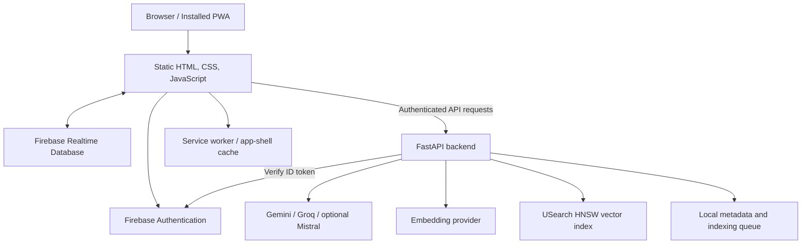

# AI-Notez

AI-Notez is a browser-based note-taking Progressive Web App (PWA) with Firebase-backed sign-in and sync, voice-note workflows, AI assistance, and a separate Python API for generation and semantic retrieval.

**Live app:** https://ai-notez.web.app/  
**Repository:** https://github.com/ShanMade/Ai-Notez

## Features

- Create and organize notes in a focused web workspace.
- Sign in through Firebase Authentication and sync user data with Firebase Realtime Database.
- Use AI generation through configured Gemini and Groq providers; Mistral support can be enabled in backend configuration.
- Work with voice-note and transcription workflows, including configurable voice profiles.
- Index notes and retrieve relevant content through semantic search when embeddings are configured.
- Install the app as a PWA; the service worker caches the app shell for improved repeat-load/offline behavior.
- Use a standalone FastAPI backend for AI requests, indexing, and search.

> Feature availability depends on app configuration, provider credentials, browser permissions, network access, and the deployed backend. Offline app-shell caching does not mean every AI or cloud feature works offline.

## Architecture



### Main components

- **Frontend:** `index.html`, `styles/app.css`, and the ordered JavaScript modules in `app/`.
- **Identity and synced data:** Firebase Authentication and Firebase Realtime Database.
- **Backend API:** FastAPI/Uvicorn under `backend/app/`. It verifies Firebase ID tokens for protected routes, exposes AI generation and retrieval endpoints, and applies request limits.
- **AI providers:** Provider adapters and model selection live in `backend/app/providers.py`; credentials are configured through environment variables.
- **Retrieval/indexing:** Indexing and queue orchestration live in `backend/app/indexing.py`; vector-index management is in `backend/app/vector_store.py`. Backend metadata and index files are stored under `NOTEZ_DATA_DIR`.
- **Hosting/deployment:** Firebase Hosting serves the static frontend. The Python API must be deployed separately to a Python-capable host and configured with the correct API base URL and CORS origins.

## Repository layout

```text
.
├── index.html
├── styles/
│   └── app.css
├── app/                     # Frontend JavaScript modules
├── backend/
│   ├── app/
│   │   ├── main.py          # FastAPI routes and request handling
│   │   ├── auth.py          # Firebase token verification
│   │   ├── config.py        # Environment-based settings
│   │   ├── firebase.py      # Firebase data access
│   │   ├── providers.py     # AI and embedding provider adapters
│   │   ├── indexing.py      # Indexing and retrieval orchestration
│   │   └── vector_store.py  # Vector index operations
│   ├── tests/
│   ├── pyproject.toml
│   └── requirements.txt
├── .github/workflows/deploy.yml
├── firebase.json
├── database.rules.json
├── manifest.webmanifest
├── sw.js
└── README.md
```

## Run the frontend locally

The frontend is static, so it does not require a JavaScript build step.

1. Clone the repository.
2. Serve the repository root using a local HTTP server (rather than opening `index.html` as a `file://` URL).
3. Open the local URL in your browser.
4. Configure Firebase and the backend endpoint using the same mechanism as the deployed app. Authentication, sync, and AI features will not work until their services are configured.

For example, if Python is installed, run this from the repository root:

```bash
python -m http.server 8000
```

Then visit `http://localhost:8000`. This only serves the static files; it does **not** start the API.

## Run the backend locally

The backend targets **Python 3.12**.

```bash
cd backend
python -m venv .venv
```

Activate the virtual environment:

- **Windows PowerShell:** `.venv\\Scripts\\Activate.ps1`
- **macOS/Linux:** `source .venv/bin/activate`

Install dependencies and create your environment file:

```bash
python -m pip install -r requirements.txt
copy .env.example .env
```

The `copy` command is for Windows. On macOS/Linux, use `cp .env.example .env`. If you place `.env.example` at the repository root instead, adjust the copy path accordingly; keep real credentials out of Git.

Run the API from the `backend` directory:

```bash
uvicorn app.main:app --reload
```

The health endpoint is available at `http://127.0.0.1:8000/healthz`. Interactive API documentation is normally available at `http://127.0.0.1:8000/docs`.

### Environment variables

See [`backend/.env.example`](backend/.env.example) for a template. Common settings include:

| Variable | Purpose |
|---|---|
| `FIREBASE_PROJECT_ID` | Firebase project ID |
| `FIREBASE_API_KEY`, `FIREBASE_AUTH_DOMAIN`, `FIREBASE_DATABASE_URL`, `FIREBASE_STORAGE_BUCKET`, `FIREBASE_MESSAGING_SENDER_ID`, `FIREBASE_APP_ID` | Firebase web configuration served by the backend |
| `FIREBASE_SERVICE_ACCOUNT_JSON` | Service-account JSON used by server-side Firebase verification/access; keep it secret |
| `AI_DEFAULT_PROVIDER` | Default provider: `gemini`, `groq`, or `mistral` |
| `AI_GEMINI_API_KEY`, `AI_GROQ_API_KEY`, `AI_MISTRAL_API_KEY` | Provider credentials |
| `AI_MISTRAL_ENABLED` | Enable Mistral support when set to `true` |
| `AI_EMBEDDING_API_KEY`, `AI_EMBEDDING_PROVIDER`, `AI_EMBEDDING_MODEL`, `AI_EMBEDDING_DIMENSIONS` | Embedding provider and vector configuration |
| `NOTEZ_CORS_ORIGINS` | Comma-separated allowed browser origins |
| `NOTEZ_DATA_DIR` | Directory for local backend index/metadata data |
| `AI_REQUEST_TIMEOUT_SECONDS`, `AI_MAX_PROMPT_CHARS`, `AI_MAX_CHUNKS_PER_USER`, `AI_MAX_INDEXED_NOTES`, `AI_MAX_SEARCH_RESULTS`, `AI_MIN_SIMILARITY`, `AI_RAG_MAX_INDEX_UPDATES` | Backend timeouts, limits, and retrieval tuning |

Only set provider credentials for services you intend to use. Never commit real `.env` files, service-account JSON, or API keys.

When `AI_EMBEDDING_PROVIDER` is `groq` or `mistral`, `AI_EMBEDDING_DIMENSIONS` must be `1024` (their fixed
output size); the backend refuses to start with a mismatched value instead of failing at retrieval time.

### Retrieval (RAG)

`POST /v1/ai/generate` retrieves current notes before generation. The backend keeps a per-user vector index
in `NOTEZ_DATA_DIR`, refreshes at most `AI_RAG_MAX_INDEX_UPDATES` changed notes per chat request, and falls
back to keyword matching over the live Firebase notes when embeddings are unavailable. Retrieval never uses
notes from another account, and index hits are dropped when the note was deleted or edited since indexing.
See [`backend/RAG_AUDIT.md`](backend/RAG_AUDIT.md) for the audit notes and tuning guidance.

## Tests

Backend tests are located in `backend/tests/`. From the `backend` directory, install dependencies and run:

```bash
python -m pytest
```

If pytest is not included in the runtime dependencies, install it in your development environment first. Browser-only behavior such as microphone permissions, recording, service-worker caching, and Firebase sign-in should also be tested in a real supported browser.

## Deployment

### Frontend (Firebase Hosting)

The GitHub Actions workflow is at `.github/workflows/deploy.yml`. Review that workflow before use and configure the repository secrets it expects. The current workflow references `FIREBASE_SERVICE_ACCOUNT_AI_NOTEZ`. Ensure the Firebase project and hosting target match the intended deployment.

You can also deploy manually with the Firebase CLI after installing it and authenticating:

```bash
firebase deploy --only hosting
```

Run the command from the repository root and verify the selected Firebase project before deploying.

### Backend

Firebase Hosting serves the static site; it does not run the FastAPI application. Deploy `backend/` to a Python-capable service, set the required environment variables, persist `NOTEZ_DATA_DIR` if you need the local index/metadata to survive restarts, and set `NOTEZ_CORS_ORIGINS` to the exact frontend origins. Configure the frontend to call the deployed API endpoint.

## Security and operational notes

- Firebase client configuration is not a substitute for database security rules. Review `database.rules.json` and enforce per-user access in Firebase.
- Keep service-account JSON and AI provider keys on the server. Do not commit secrets or expose service-account credentials to the frontend.
- The API uses Firebase authentication for protected operations and includes in-process request limits. For multi-instance production deployments, consider shared rate limiting and durable/shared indexing infrastructure.
- A client-side PIN or UI lock, if enabled in the app, should not be described as encryption unless the note data is actually encrypted at rest with a properly managed key.
- Test microphone access, browser compatibility, Firebase rules, CORS, provider quotas, and persistence before a production release.

## License

See [LICENSE](LICENSE).
