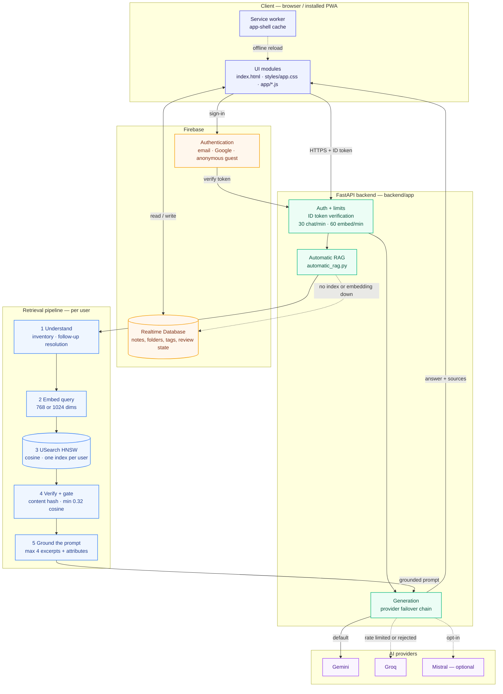

# AI-Notez

AI-Notez is a browser-based note-taking Progressive Web App (PWA) with Firebase-backed sign-in and sync, voice-note workflows, AI assistance, and a separate Python API for generation and semantic retrieval. The assistant answers with **retrieval-augmented generation (RAG)**: questions are embedded, matched against a per-user vector index, and answered only from notes that clear a confidence threshold.

**Live app:** https://ai-notez.web.app/  
**Repository:** https://github.com/ShanMade/Ai-Notez

## Features

- Create and organize notes in a focused web workspace.
- Sign in through Firebase Authentication and sync user data with Firebase Realtime Database.
- Use AI generation through configured Gemini and Groq providers; Mistral support can be enabled in backend configuration.
- Work with voice-note and transcription workflows, including configurable voice profiles.
- Semantic search over your notes through a per-user vector index (USearch HNSW, cosine similarity), fused with keyword matching so exact terms and identifiers still hit.
- RAG answers: the assistant quotes only notes above a confidence threshold, cites them as openable sources, and says so instead of inventing an answer when nothing matches.
- Read answers comfortably: the assistant panel is resizable (drag its left edge, arrow keys, or double-click to reset) and has its own text-size control, both remembered per device. LaTeX (`\( … \)`, `\[ … \]`, `$$ … $$`) is rendered with KaTeX in answers and notes.
- Install the app as a PWA; the service worker caches the app shell for improved repeat-load/offline behavior.
- Use a standalone FastAPI backend for AI requests, indexing, and search.

> Feature availability depends on app configuration, provider credentials, browser permissions, network access, and the deployed backend. Offline app-shell caching does not mean every AI or cloud feature works offline.

## Architecture



Solid arrows are the request path; dashed arrows are fallbacks and background paths. The numbered nodes are
the retrieval pipeline described in [How a question is answered](#how-a-question-is-answered).

<details>
<summary>Diagram as text (screen readers, or if the diagram does not load)</summary>

```text
Client — browser / installed PWA
├── UI modules            index.html · styles/app.css · app/*.js
├── Service worker        app-shell cache
│
├──► Firebase Authentication   email · Google · anonymous guest
├──► Firebase Realtime Database  notes, folders, tags, review state
└──► FastAPI backend  (backend/app)
     ├── Auth + limits       ID token verification · 30 chat/min · 60 embed/min
     ├── Generation          provider failover chain
     └── Automatic RAG       automatic_rag.py
          ├── 1 Understand   inventory · follow-up resolution
          ├── 2 Embed query  768 or 1024 dims
          ├── 3 USearch HNSW cosine · one index per user
          ├── 4 Verify + gate content hash · min 0.32 cosine
          └── 5 Ground prompt max 4 excerpts + attributes

AI providers: Gemini (default) → Groq (rate limited or rejected) → Mistral (opt-in)
```

</details>

### Main components

- **Frontend:** `index.html`, `styles/app.css`, the ordered JavaScript modules in `app/`, and `vendor/katex/` (KaTeX for math rendering).
- **Identity and synced data:** Firebase Authentication and Firebase Realtime Database.
- **Backend API:** FastAPI/Uvicorn under `backend/app/`. It verifies Firebase ID tokens for protected routes, exposes AI generation and retrieval endpoints, and applies request limits.
- **AI providers:** Provider adapters and model selection live in `backend/app/providers.py`; credentials are configured through environment variables.
- **Retrieval (RAG):** `backend/app/automatic_rag.py` turns a question into a grounded prompt, `backend/app/indexing.py` handles indexing and the queue, and `backend/app/vector_store.py` owns chunking, the USearch HNSW index and hybrid ranking. Backend metadata and index files are stored under `NOTEZ_DATA_DIR`. The browser calls the hybrid search endpoint from `app/09-knowledge-index.js`.
- **Hosting/deployment:** Firebase Hosting serves the static frontend. The Python API must be deployed separately to a Python-capable host and configured with the correct API base URL and CORS origins.

## Repository layout

```text
.
├── index.html
├── styles/
│   └── app.css
├── app/                     # Frontend JavaScript modules
├── backend/
│   ├── app/
│   │   ├── main.py          # FastAPI routes and request handling
│   │   ├── auth.py          # Firebase token verification
│   │   ├── config.py        # Environment-based settings
│   │   ├── firebase.py      # Firebase data access
│   │   ├── providers.py     # AI and embedding provider adapters
│   │   ├── indexing.py      # Indexing and retrieval orchestration
│   │   └── vector_store.py  # Vector index operations
│   ├── RAG_AUDIT.md         # Retrieval audit notes and tuning guidance
│   ├── tests/
│   ├── pyproject.toml
│   └── requirements.txt
├── .github/workflows/deploy.yml
├── firebase.json
├── database.rules.json
├── manifest.webmanifest
├── sw.js
└── README.md
```

## Run the frontend locally

The frontend is static, so it does not require a JavaScript build step.

1. Clone the repository.
2. Serve the repository root using a local HTTP server (rather than opening `index.html` as a `file://` URL).
3. Open the local URL in your browser.
4. Configure Firebase and the backend endpoint using the same mechanism as the deployed app. Authentication, sync, and AI features will not work until their services are configured.

For example, if Python is installed, run this from the repository root:

```bash
python -m http.server 8000
```

Then visit `http://localhost:8000`. This only serves the static files; it does **not** start the API.

## Run the backend locally

The backend targets **Python 3.12**.

```bash
cd backend
python -m venv .venv
```

Activate the virtual environment:

- **Windows PowerShell:** `.venv\\Scripts\\Activate.ps1`
- **macOS/Linux:** `source .venv/bin/activate`

Install dependencies and create your environment file:

```bash
python -m pip install -r requirements.txt
copy .env.example .env
```

The `copy` command is for Windows. On macOS/Linux, use `cp .env.example .env`. If you place `.env.example` at the repository root instead, adjust the copy path accordingly; keep real credentials out of Git.

Run the API from the `backend` directory:

```bash
uvicorn app.main:app --reload
```

The health endpoint is available at `http://127.0.0.1:8000/healthz`. Interactive API documentation is normally available at `http://127.0.0.1:8000/docs`.

### Environment variables

See [`backend/.env.example`](backend/.env.example) for a template. Common settings include:

| Variable | Purpose |
|---|---|
| `FIREBASE_PROJECT_ID` | Firebase project ID |
| `FIREBASE_API_KEY`, `FIREBASE_AUTH_DOMAIN`, `FIREBASE_DATABASE_URL`, `FIREBASE_STORAGE_BUCKET`, `FIREBASE_MESSAGING_SENDER_ID`, `FIREBASE_APP_ID` | Firebase web configuration served by the backend |
| `FIREBASE_SERVICE_ACCOUNT_JSON` | Service-account JSON used by server-side Firebase verification/access; keep it secret |
| `AI_DEFAULT_PROVIDER` | Default provider: `gemini`, `groq`, or `mistral` |
| `AI_GEMINI_API_KEY`, `AI_GROQ_API_KEY`, `AI_MISTRAL_API_KEY` | Provider credentials |
| `AI_MISTRAL_ENABLED` | Enable Mistral support when set to `true` |
| `AI_EMBEDDING_API_KEY`, `AI_EMBEDDING_PROVIDER`, `AI_EMBEDDING_MODEL`, `AI_EMBEDDING_DIMENSIONS` | Embedding provider and vector configuration |
| `NOTEZ_CORS_ORIGINS` | Comma-separated allowed browser origins |
| `NOTEZ_DATA_DIR` | Directory for local backend index/metadata data |
| `AI_GROQ_TRANSCRIBE_MODEL` | Whisper model used for Voice-to-Note fallback transcription |
| `AI_REQUEST_TIMEOUT_SECONDS`, `AI_MAX_PROMPT_CHARS`, `AI_MAX_CHUNKS_PER_USER`, `AI_MAX_INDEXED_NOTES`, `AI_MAX_SEARCH_RESULTS`, `AI_MIN_SIMILARITY`, `AI_RAG_MAX_INDEX_UPDATES`, `AI_RAG_MIN_CONFIDENCE`, `AI_RAG_MAX_EXCERPTS` | Backend timeouts, limits, and retrieval tuning |

Only set provider credentials for services you intend to use. Never commit real `.env` files, service-account JSON, or API keys.

When `AI_EMBEDDING_PROVIDER` is `groq` or `mistral`, `AI_EMBEDDING_DIMENSIONS` must be `1024` (their fixed
output size); the backend refuses to start with a mismatched value instead of failing at retrieval time.

### Voice-to-Note transcription

Audio parts sent to `POST /v1/ai/generate` are transcribed by Gemini, and fall over to Groq's Whisper
endpoint (`AI_GROQ_TRANSCRIBE_MODEL`, default `whisper-large-v3-turbo`) when Gemini is rate limited or
rejects its credential — the resulting transcript is then formatted by a Groq chat model so speaker labels
and structure stay the same. A provider that is cooling down after a rate limit is tried last rather than
skipped, so a single 429 never becomes "all providers failed". The browser keeps each failed part's audio
and offers a retry instead of discarding it.

### Retrieval settings

The `AI_RAG_*` variables tune the pipeline described in
[Semantic search and RAG](#semantic-search-and-rag). `AI_RAG_MIN_CONFIDENCE` (default `0.32`) is the cosine
score a note must reach before its text is quoted, `AI_RAG_MAX_EXCERPTS` (default `4`) caps how many notes
are quoted per answer, and `AI_RAG_MAX_INDEX_UPDATES` (default `24`) caps how many changed notes are
re-embedded per chat request. `AI_MIN_SIMILARITY` (default `0.18`) is the floor applied to individual
chunk hits before ranking, in both RAG and the search endpoints.

## Semantic search and RAG

AI-Notez answers from your notes with **retrieval-augmented generation (RAG)**: the backend embeds the
question, searches a per-user vector index, verifies every hit against Firebase, and only then hands the
model the passages it is allowed to quote.

### How a question is answered

1. **Understand the query.** `POST /v1/ai/generate` reads the last user turn. Library-inventory questions
   are answered from the authoritative note list instead of similarity search, and short follow-ups such as
   “largest?” are resolved against the previous turn before anything is embedded.
2. **Embed.** The question is embedded with the configured embedding model (`gemini-embedding-001` by
   default, 768 dimensions; Groq and Mistral use a fixed 1024).
3. **Search.** USearch HNSW returns the nearest chunks by cosine similarity; semantic hits below
   `AI_MIN_SIMILARITY` (default `0.18`) are discarded. Hybrid search then blends the remaining hits
   with bounded keyword relevance: `score = similarity + 0.35 × keyword relevance`, where keyword relevance
   is the share of the query's meaningful terms a chunk contains, plus a small bonus for quoted phrases and
   identifiers such as `chapter-3` or `fig2`.
4. **Verify.** Each hit is checked against the live Firebase note. A hit whose content hash no longer matches
   is dropped, so a deleted or edited note can never be quoted from a stale index — Firebase stays the source
   of truth and the index is only a cache.
5. **Gate on confidence.** A note is quoted only when it reaches `AI_RAG_MIN_CONFIDENCE` (default `0.32`)
   **and** stays within `0.15` of the best hit. Weaker results produce an explicit "no confident match"
   instruction, so the model asks a clarifying question instead of inventing an answer or a note count.
6. **Ground the model.** Up to `AI_RAG_MAX_EXCERPTS` (default `4`) excerpts are passed in, each with computed
   attributes — title, folder, subject, word and character count, last update and the cosine score — plus a
   rule block that forbids reporting retrieval counts. Comparative questions (“largest”, “shortest”, “most
   recent”) are answered from those attributes rather than from loose similarity.
7. **Cite.** Notes that were used come back as `sources`, which the chat renders as openable chips instead of
   a wall of links.

### The vector database

The vector database is [USearch](https://github.com/unum-cloud/usearch) — one HNSW graph per user, searched
by cosine similarity — with chunk text, content hashes and the indexing queue kept in SQLite beside it.

| Detail | Implementation |
|---|---|
| Index type | USearch HNSW, `metric="cos"`, `f32`, dimensions pinned to the active embedding profile |
| Scope | One index per user, keyed by a hash of the Firebase uid — retrieval never crosses accounts |
| Scoped search | Note- and folder-scoped queries score every chunk of that scope directly in SQLite, so a question about the open note cannot miss it |
| Chunking | 1,600 characters per chunk with 200 characters of overlap, split on word boundaries |
| Metadata | SQLite (`notez-vectors.sqlite3`): chunk text, content hash, embedding model, chunk counts and the indexing queue |
| Storage | `NOTEZ_DATA_DIR` — `indexes/<owner>.usearch` plus the SQLite file; persist this directory to survive restarts |
| Freshness | At most `AI_RAG_MAX_INDEX_UPDATES` (default `24`) changed notes are re-embedded per chat request; unchanged notes are skipped by content hash |
| Limits | Up to `AI_MAX_INDEXED_NOTES` (5,000) notes and `AI_MAX_CHUNKS_PER_USER` (20,000) chunks per user; a note above the chunk cap is rejected with `413` |

Changing `AI_EMBEDDING_PROVIDER`, `AI_EMBEDDING_MODEL` or `AI_EMBEDDING_DIMENSIONS` invalidates the stored
vectors, so the affected user's chunks are dropped and re-embedded by the next note save, rebuild or
backfill instead of serving vectors the new model can never match.

### Index and search endpoints

| Endpoint | Purpose |
|---|---|
| `POST /v1/index/notes/{note_id}` | Embed and upsert one note; if the embedding provider is rate limited the note stays saved and a later rebuild or backfill indexes it |
| `DELETE /v1/index/notes/{note_id}` | Remove a note from the index |
| `POST /v1/index/rebuild` | Rebuild the caller's index from their current notes |
| `POST /v1/index/backfill` | Queue a background backfill of notes that are not indexed yet |
| `GET /v1/index/status` | Queue, backfill and index status for the caller |
| `GET /v1/index/stats` | Note and chunk counts, revision and the indexed note list |
| `POST /v1/index/search` | Semantic search, hybrid by default |
| `POST /v1/index/search/hybrid` | Semantic plus keyword search with `scope` set to `all`, `folder` or `note` |

All of these require a Firebase ID token. Generation is limited to 30 requests per user per minute and
embedding work to 60 operations per user per minute, counted in process — see
[Security and operational notes](#security-and-operational-notes) for multi-instance caveats.

### When embeddings are unavailable

If no embedding key is configured, the embedding provider is rate limited, or the index is still empty,
retrieval falls back to keyword matching over the live Firebase notes. When nothing matches, the model is
told that no confident match exists and must ask one clarifying question rather than invent notes, titles or
counts. [`backend/RAG_AUDIT.md`](backend/RAG_AUDIT.md) records the audit behind these rules and how to tune
them.

## Tests

Backend tests are located in `backend/tests/`. From the `backend` directory, install dependencies and run:

```bash
python -m pytest
```

If pytest is not included in the runtime dependencies, install it in your development environment first. Browser-only behavior such as microphone permissions, recording, service-worker caching, and Firebase sign-in should also be tested in a real supported browser.

## Deployment

### Frontend (Firebase Hosting)

The GitHub Actions workflow is at `.github/workflows/deploy.yml`. Review that workflow before use and configure the repository secrets it expects. The current workflow references `FIREBASE_SERVICE_ACCOUNT_AI_NOTEZ`. Ensure the Firebase project and hosting target match the intended deployment.

You can also deploy manually with the Firebase CLI after installing it and authenticating:

```bash
firebase deploy --only hosting
```

Run the command from the repository root and verify the selected Firebase project before deploying.

### Backend

Firebase Hosting serves the static site; it does not run the FastAPI application. Deploy `backend/` to a Python-capable service, set the required environment variables, persist `NOTEZ_DATA_DIR` if you need the local index/metadata to survive restarts, and set `NOTEZ_CORS_ORIGINS` to the exact frontend origins. Configure the frontend to call the deployed API endpoint.

## Security and operational notes

- Firebase client configuration is not a substitute for database security rules. Review `database.rules.json` and enforce per-user access in Firebase.
- Keep service-account JSON and AI provider keys on the server. Do not commit secrets or expose service-account credentials to the frontend.
- The API uses Firebase authentication for protected operations and includes in-process request limits. For multi-instance production deployments, consider shared rate limiting and durable/shared indexing infrastructure.
- A client-side PIN or UI lock, if enabled in the app, should not be described as encryption unless the note data is actually encrypted at rest with a properly managed key.
- Test microphone access, browser compatibility, Firebase rules, CORS, provider quotas, and persistence before a production release.

## License

See [LICENSE](LICENSE).
